# Corne v3 wireless ZMK config

ZMK firmware config for a Corne v3 (6 column) with nice!nano v2 (or a compatible ProMicro NRF52840 clone), 0.91" I2C OLED displays, per-key RGB and underglow.
Based on [typeractivexyz/corne-wireless-view-zmk-config](https://github.com/typeractivexyz/corne-wireless-view-zmk-config).

## Keymap



The image is regenerated by [keymap-drawer](https://github.com/caksoylar/keymap-drawer) on every push that touches `config/corne.keymap`.

## Lighting

ZMK drives the 21 per-key LEDs and the 6 underglow LEDs of each half as a single WS2812 chain, so both are controlled by the RGB underglow feature.

- `config/corne.conf` enables `CONFIG_ZMK_RGB_UNDERGLOW` and `CONFIG_WS2812_STRIP`, turns the LEDs off when idle and starts at 40% brightness.
- `config/corne.keymap` sets `chain-length = <27>` on the LED strip (21 per-key + 6 underglow per half).
- The Lower layer exposes RGB controls on the bottom row: toggle, next effect, hue, saturation, brightness up and brightness down.

RGB behaviors are global, so a key press on either half changes both sides.

## Hardware notes

Assembly from scratch, step by step with photos: [docs/build-guide.md](docs/build-guide.md).

Pin map, OLED header order, LED chain order and soldering troubleshooting: [docs/hardware.md](docs/hardware.md).

## Display

Each half uses the standard Corne 0.91" 128x32 I2C OLED (SSD1306) plugged into the `OLED` header. `CONFIG_ZMK_DISPLAY=y` turns it on. The OLED talks I2C on pins `017` and `020`, so it does not interfere with the LED data line on `006`.

Solder the 4-pin header to the display, then solder the display into the PCB header with `GND` on the display aligned to `GND` on the PCB silkscreen.

## Controller

A nice!nano v2 or a compatible clone such as the ProMicro NRF52840 (Supermini), mounted components down. The `nice_nano_v2` board target works for both.

## Building

Pushing to `main` runs GitHub Actions and produces `corne_left` and `corne_right` `.uf2` files under the `firmware` artifact of the workflow run.

## Flashing

1. Plug the half into USB.
2. Double tap the reset button to enter the bootloader.
3. Copy the matching `.uf2` to the `NICENANO` drive.
4. Repeat for the other half.

## Local keymap render

```sh
uvx --from keymap-drawer keymap -c keymap_drawer.config.yaml parse -z config/corne.keymap > keymap-drawer/corne.yaml
uvx --from keymap-drawer keymap -c keymap_drawer.config.yaml draw keymap-drawer/corne.yaml > keymap-drawer/corne.svg
```
