# Build guide

Step-by-step assembly of this Corne Cherry v3.0.1 as a wireless board with ProMicro NRF52840 controllers, 0.91" OLEDs, per-key RGB and underglow. It follows the order of the [official foostan guide](https://github.com/foostan/crkbd/blob/main/docs/corne-cherry/v3/buildguide_en.md) and adapts it to these parts. Photos in `img/crkbd/` are from the official guide, MIT licensed, copyright foostan.

For pin maps, the OLED header order and the LED chain order, see [hardware.md](hardware.md).

## Parts

| Part | Qty | Notes |
|---|---|---|
| Corne Cherry v3.0.1 PCB | 1 set | left and right halves, hotswap variant |
| ProMicro NRF52840 (Supermini) | 2 | nice!nano v2 clone. Any nice!nano compatible board works |
| Controller sockets, 12 pins | 4 | one pair per half, lets the controller come out later |
| Controller pins | 48 | Mill-Max pins or diode legs, soldered to the controller |
| 0.91" 128x32 I2C OLED, `GND VCC SCK SDA` | 2 | |
| OLED socket, 4 pins | 2 | goes on the PCB |
| OLED pin header, 4 pins | 2 | soldered to the display |
| Diodes SOD-123 | 42 | 1N4148W or similar |
| SK6812 MINI-E | 42 | per-key, reverse mount |
| WS2812B 5050 | 12 | underglow |
| Reset switch, 2 pin tact | 2 | |
| MX hotswap sockets, Kailh or Gateron | 42 | |
| MX switches | 42 | |
| Keycaps | 42 | 40 x 1u, 2 x 1.5u |
| LiPo battery, 110 to 301230 size, with JST or bare leads | 2 | wireless only |
| Slide switch | 2 | optional, to cut the battery |
| Case or plates, M2 screws, spacers, rubber feet | 1 set | this build uses a 3D printed case |

Not needed on a wireless build: TRRS jack and cable. With a nice!nano style controller on both sides the halves talk over Bluetooth. Do not connect a TRRS cable between two powered controllers.

## Tools

Soldering iron with a fine tip, leaded solder 0.5 to 0.8 mm, flux pen or paste, fine tweezers, a multimeter for continuity checks, isopropyl alcohol for cleaning, a magnifier or phone camera for inspecting LED pads.

## 1. Check the PCB

Compare your boards with the official photos. Each half is its own PCB. The controller, the OLED and the diodes go on the top side; the LEDs and the hotswap sockets go on the bottom side.

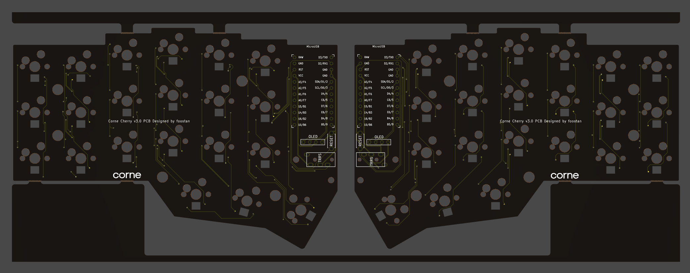

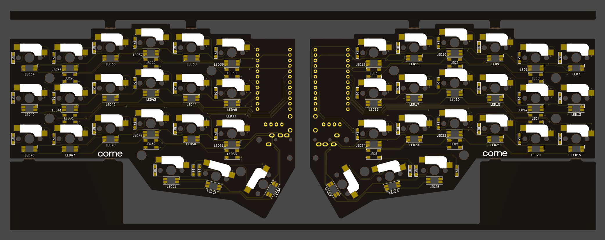

If the PCB still has the manufacturing frame, snap it off at the eight joints and file the stubs.

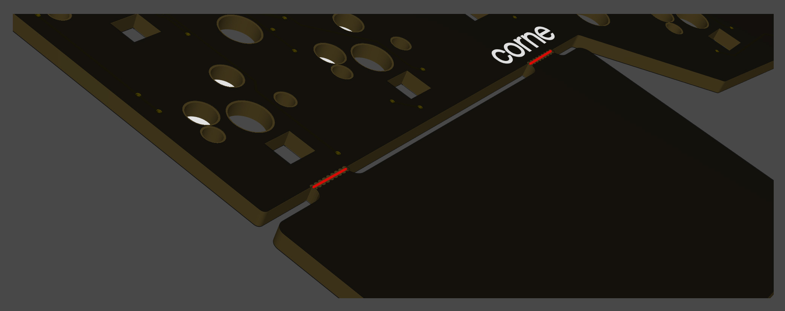

## 2. Flash the controllers first

Flashing before soldering lets you test each stage. Download the `firmware` artifact from the latest run in the Actions tab of this repo, plug a controller in, double tap reset, and copy `corne_left...uf2` to the left one and `corne_right...uf2` to the right one. The drive shows up as `NICENANO`. Mark the controllers so they do not get swapped.

## 3. Diodes, top side

Diodes are polarized. The bar printed on the diode goes to the bar side of the silkscreen symbol `|◁`. Tin one pad, slide the diode in while reheating, then solder the other pad. 21 per half.

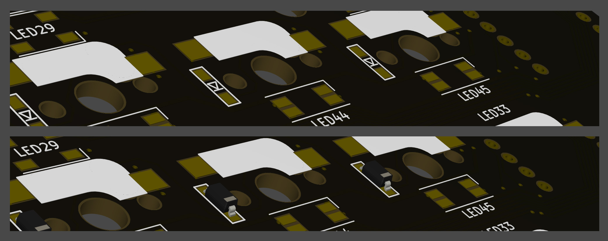

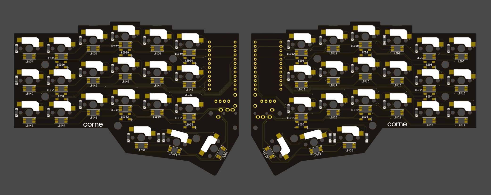

## 4. LEDs, bottom side

Both LED types are soldered from the back. The SK6812 MINI-E shine up through the switch hole, the WS2812B shine down.

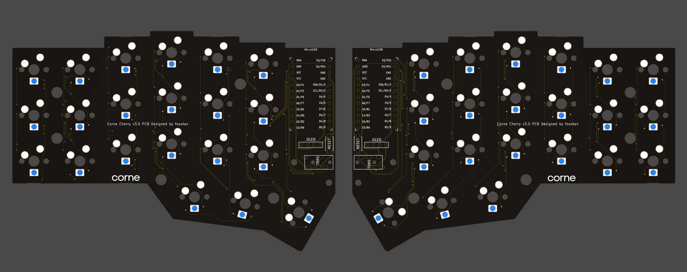

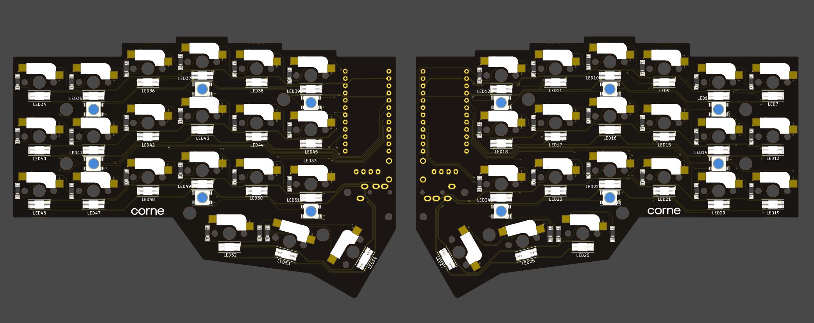

Order matters: data enters underglow LED 1 and passes through all 27 LEDs in series. Any bad joint or rotated LED leaves everything after it dark. The chain order is drawn in [hardware.md](hardware.md#leds).

### 4a. WS2812B underglow

Match the recessed corner of the LED with the marked corner on the silkscreen. 6 per half.

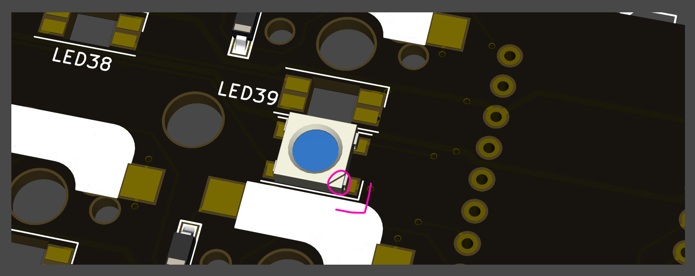

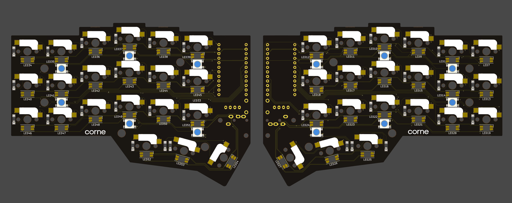

### 4b. SK6812 MINI-E per-key

Match the notched corner of the LED with the mark on the silkscreen. The LED sits in the cutout with the lens facing the switch hole. Keep the iron around 320 °C and do not dwell on a pad; these die from heat. 21 per half.

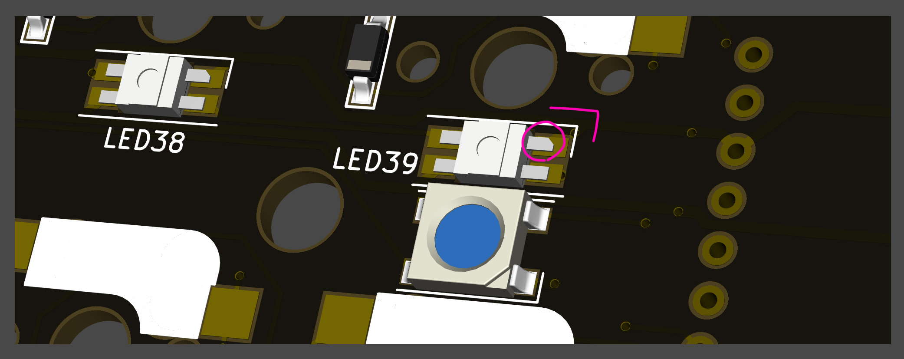

After every column, plug the controller in temporarily and check how far the chain lights. Finding a dead LED now is much easier than after the sockets are on.

## 5. Reset switch, OLED socket, controller sockets

Solder the reset switch and the 4-pin OLED socket on the top side. Skip the TRRS jack. Then solder the two 12-pin controller sockets. Tape the parts down so they stay flat while soldering.

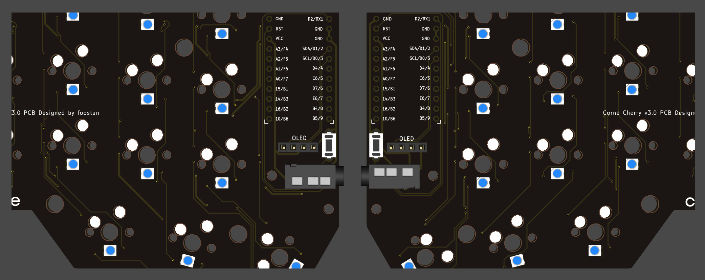

## 6. Controller

The controller goes in with the components facing the PCB and the USB port at the top edge, so the pin labels on its back face up and match the PCB silkscreen (`RAW` on the left column, `D3/TX0` on the right column). Solder the pins to the controller, not to the PCB, so it stays removable.

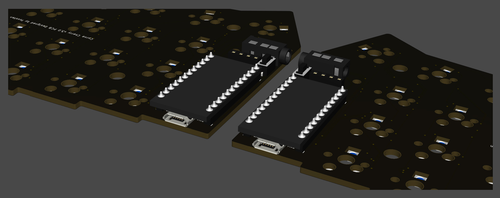

Power the half over USB. The OLED socket is still empty, so just check that the controller enumerates and that the LEDs light. Shorting the two pads of a hotswap footprint with tweezers should type a key.

## 7. OLED

Solder the 4-pin header to the display. Insert the header in the socket, solder one pin, reheat and level the display, then solder the rest. The header order on the PCB, left to right with the USB up, is `SDA SCL VCC GND`, which matches a display labeled `GND VCC SCK SDA` mounted face up and pointing at the USB. Confirm with a multimeter that the display's GND pin has continuity to a GND pin of the controller before powering it.

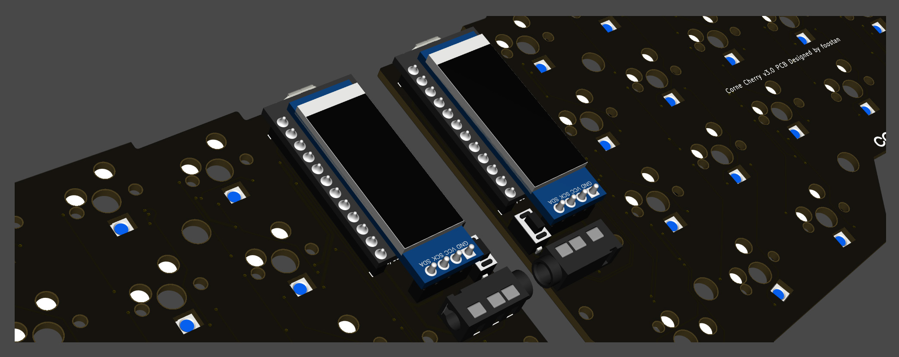

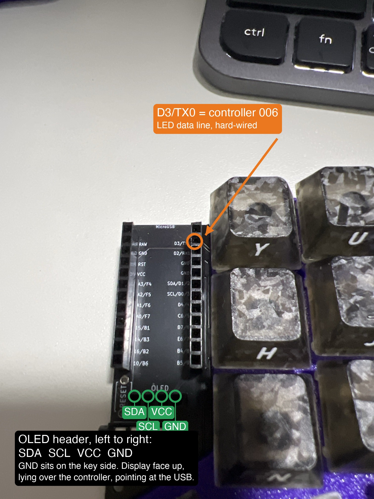

## 8. Hotswap sockets, bottom side

Tin one pad, press the socket in while reheating, then the other pad. The socket outline on the silkscreen shows the orientation. 21 per half.

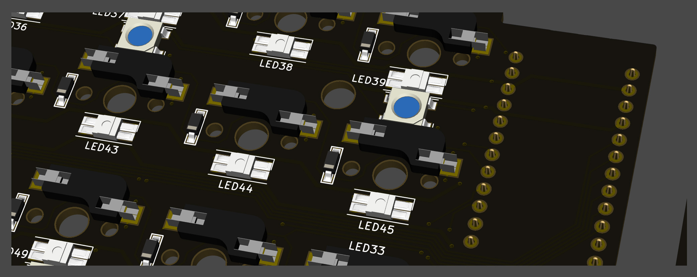

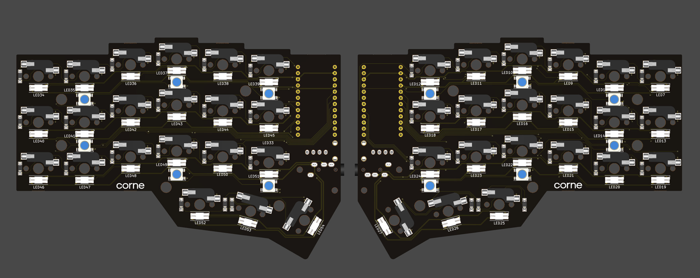

## 9. Battery and power switch

The Corne v3 PCB has no battery pads, so the battery connects to the controller. On a nice!nano style board the battery positive goes to `B+` and negative to `B-`, the two small pads on the underside next to the USB port, or to the `RAW` and `GND` header pins. Put the slide switch in series with the positive lead if you want to cut power for transport. Check polarity twice; the battery connector color is not a standard.

Charging happens over USB at about 100 mA. The battery lives under the controller or in a pocket of the case; keep it away from the soldering iron and from screw heads.

## 10. Case, switches, keycaps

With a 3D printed case: drop the PCB in, then push the switches through the top opening into the sockets a few at a time, holding the socket from below so it does not get pushed off its pads. With the official plates, place a few switches in the top plate first, then press into the sockets, then add M2 7.5 mm spacers and the bottom plate.

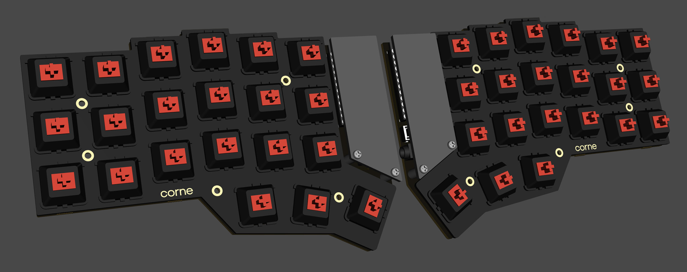

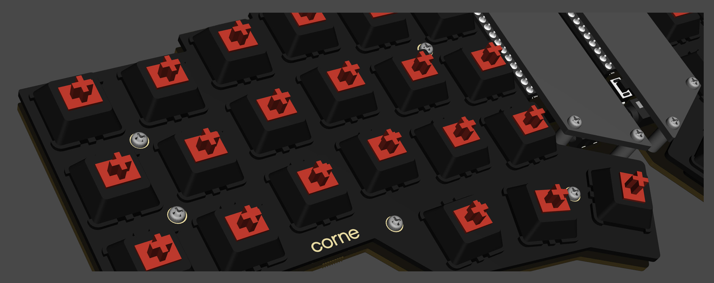

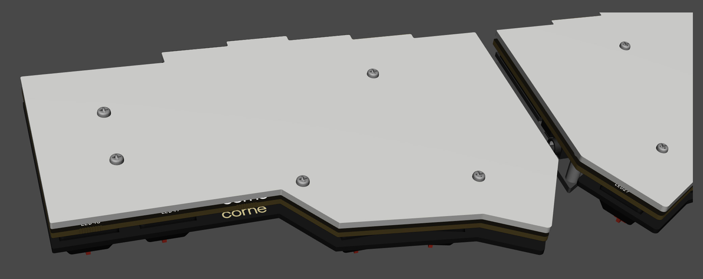

Add the rubber feet and the keycaps.

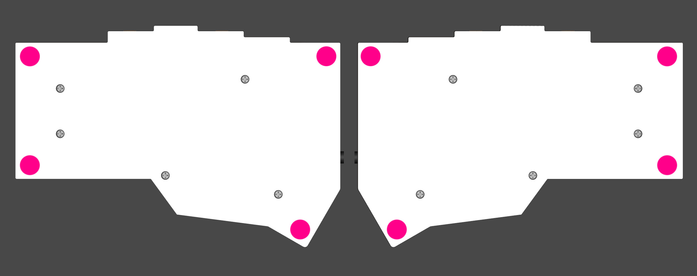

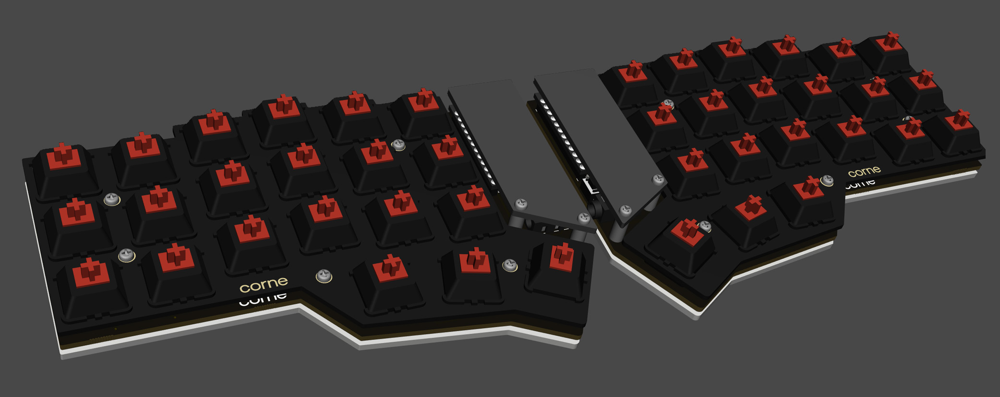

## 11. First boot and pairing

1. Power both halves. The left half is the central side and pairs with the computer; the right half pairs with the left automatically.
2. On the computer, pair with the keyboard over Bluetooth. If it does not show up, hold Lower and press BT CLR (the Ctrl key) on both halves, then try again.
3. Lower + Z toggles RGB. Lower + X cycles effects.
4. ZMK Studio over USB on the left half lets you edit the keymap live.

## Checks at each stage

| After | Check |
|---|---|
| diodes | every diode bar matches the silkscreen, no bridges between pads |
| LEDs | the chain lights to the end when the controller is plugged in |
| controller | enumerates as `NICENANO` in bootloader, keys type when pads are shorted |
| OLED | shows the layer name and the connection icon |
| sockets | each socket sits flat, both pads soldered |
| battery | voltage at `B+` reads 3.7 to 4.2 V, board runs with USB unplugged |
