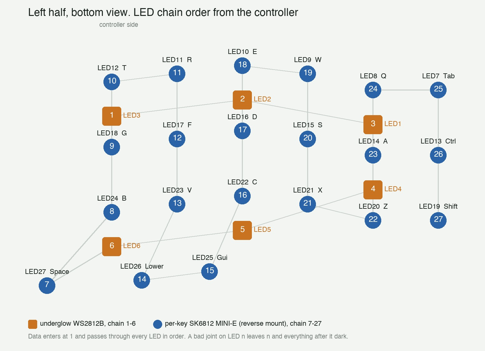
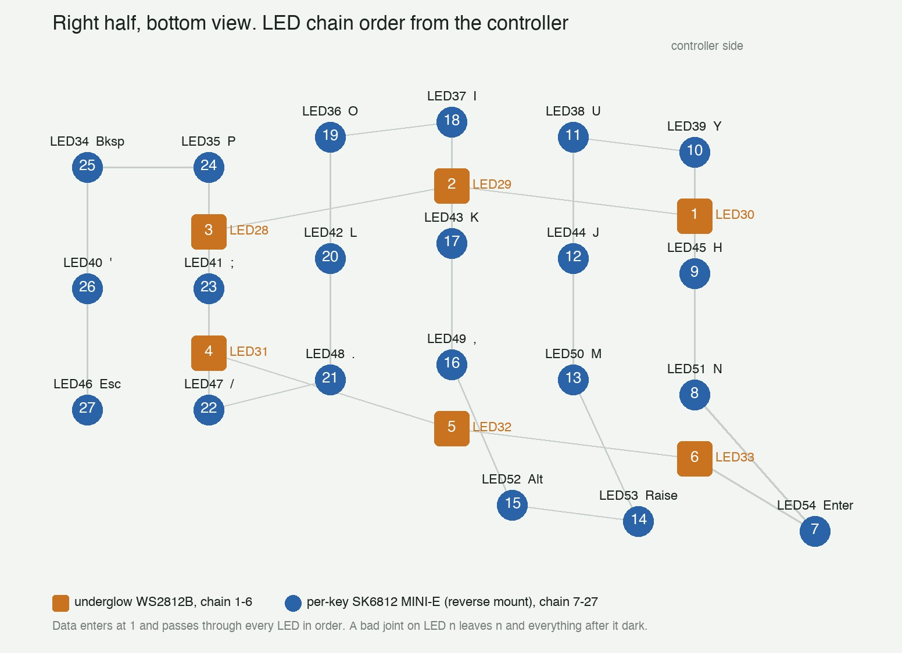

# Hardware notes

Build notes for this specific keyboard: a Corne Cherry v3.0.1 (foostan design) with ProMicro NRF52840 controllers, 0.91" I2C OLEDs, per-key RGB and underglow. Everything below was checked against the official KiCad sources at tag `corne-cherry-v3.0.1`.

## Parts

| Part | What is used here |
|---|---|
| PCB | Corne Cherry v3.0.1, hotswap, one PCB per half, controller mounted on top |
| Controller | ProMicro NRF52840 (Supermini), a nice!nano v2 clone. ZMK target `nice_nano_v2` |
| Display | 0.91" 128x32 I2C OLED (SSD1306), pins `GND VCC SCK SDA` |
| Per-key LEDs | 21 x SK6812 MINI-E per half, reverse mount on the bottom, shining up through the switch |
| Underglow | 6 x WS2812B 5050 per half, on the bottom |
| Switches | MX hotswap |

## Controller

The controller goes in with the components facing the PCB. The side with the pin labels (`006`, `008`, `017`...) faces up and lines up with the PCB silkscreen, which uses old AVR names. Flash with a double tap on reset; the drive shows up as `NICENANO`.

| PCB silkscreen | Controller pin | Function on this board |
|---|---|---|
| `D3/TX0` | `006` | LED data (SPI3 MOSI). Hard-wired, do not reuse |
| `D2/RX1` | `008` | free |
| `SDA/D1/2` | `017` | OLED SDA (I2C) |
| `SCL/D0/3` | `020` | OLED SCL (I2C) |
| `D4` `C6` `D7` `E6` | `022` `024` `100` `011` | rows 1-4 |
| `A3` `A2` `A1` `A0` `15` `14` | `031` `029` `002` `115` `113` `111` | columns |
| `16` `10` | `010` `009` | free |
| `RAW` `VCC` | `B+` `VCC` | battery and 3.3V output that feeds LEDs and OLED |

Pins `101`, `102`, `107` sit in the middle of the controller and are also free.

## OLED

The header order on the PCB, left to right with the USB pointing up, is `SDA SCL VCC GND`. A 0.91" OLED labeled `GND VCC SCK SDA` fits directly: pins down into the header, screen face up, body lying over the controller toward the USB. GND ends up on the key side.

Solder the 4-pin header to the display first, insert it in the socket, then solder the display to the header. Check with a multimeter that the GND hole has continuity to a GND pin of the controller header before powering. A reversed display dies on the first power up.

## LEDs

All 27 LEDs of a half form one chain. Data leaves the controller on pin `006`, enters underglow LED 1 and passes through every LED in order. ZMK sees the whole chain as a 27-LED underglow strip (`chain-length = <27>` in `config/corne.keymap`), so per-key and underglow always show the same effect.

Chain order per half, from the KiCad netlist:

- 1 to 6: underglow, inner top, top middle, outer top, outer bottom, bottom middle, inner bottom.
- 7 to 27: per-key, starting at the inner thumb key, snaking column by column toward the outer column.

### Soldering the LEDs

- SK6812 MINI-E go on the bottom of the PCB with the lens facing the hole. The chamfered corner of the LED matches the mark on the silkscreen. A rotated LED breaks the chain.
- Use flux and the lowest heat that flows the solder. MINI-E die easily when overheated.
- WS2812B 5050 also have a chamfered corner. Pad 4 (DIN) must face the previous LED's DOUT trace.

### Finding a broken chain

Because the signal passes through every LED, a bad joint leaves that LED and everything after it dark, while everything before it works. Power the board, note the last LED that lights, and look up the next one in the chain map above. Reflow all four pads of that LED first, then the DOUT pad of the one before it.

| What you see | Cause | Fix |
|---|---|---|
| Lights up to LED n, dark after | bad joint or rotated LED at n+1 | reflow n+1, then DOUT of n |
| Only underglow 1 and 2 light | underglow 3 (outer top corner) | reflow it |
| Underglow plus the inner two columns and thumbs light | per-key 16 (`,` on the right, `C` on the left) | reflow it, then the outer thumb key LED |
| Random few LEDs, random colors, on both halves | data line driven by something else, for example a nice!view build using pin `006` as chip select | use this repo's build, which has no nice!view |
| Nothing lights, OLED works | LED 1 or the trace from `006`, or RGB toggled off | Lower + Z toggles RGB, then check LED 1 |

## Firmware

`build.yaml` builds `corne_left` with ZMK Studio over USB and `corne_right`. `config/corne.conf` enables the OLED, the RGB strip, idle auto-off and 40% start brightness, and keeps the display powered when RGB is toggled off.

RGB keys on the Lower layer: `Z` toggle, `X` next effect, `C` hue, `V` saturation, `B` brightness up, `N` brightness down. The last state is saved to flash.
